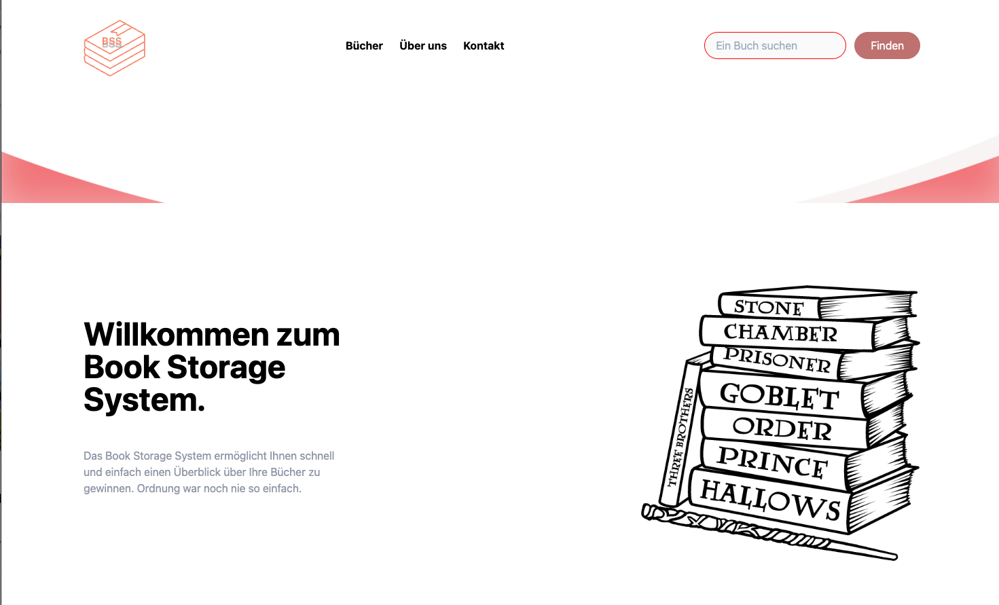
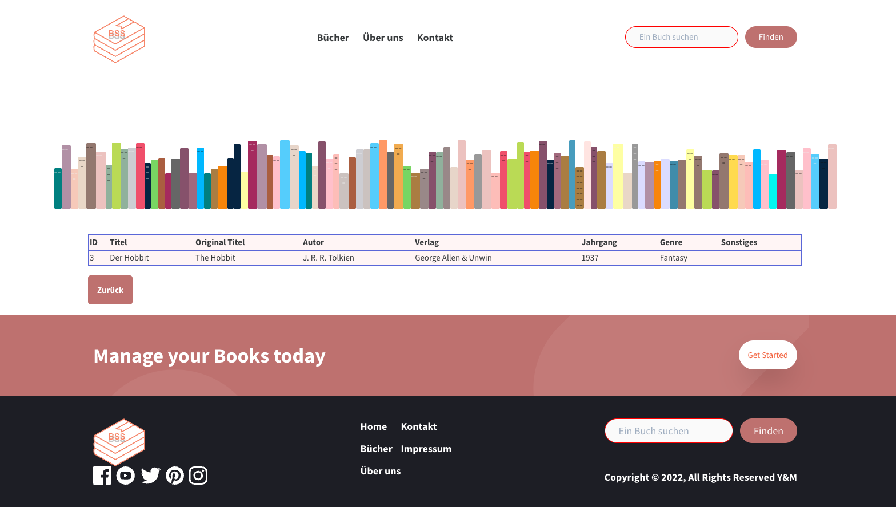
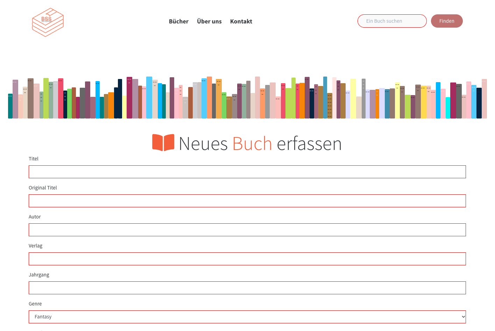
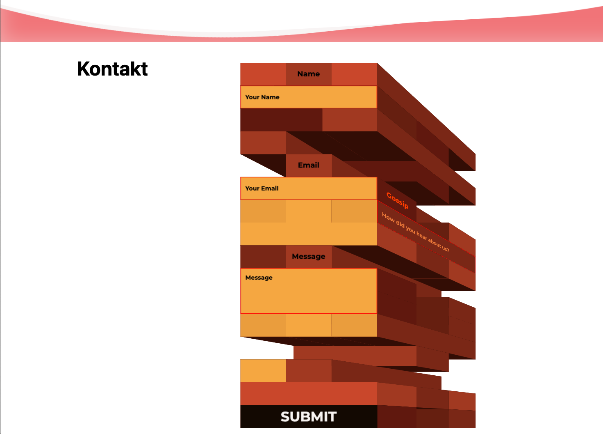

# Book Storage System (BSS)

A small PHP web app to manage a personal book collection.
Add books and find them again by title, author, genre, publisher or year.

## Screenshots

 
 


## Features

- Add books with title, original title, author, publisher, year, genre and notes
- Search across all fields, including author and genre
- Authors and genres are stored in their own tables (no duplicates)
- Responsive layout with a mobile menu
- Contact form (demo only, it shows the input but does not send an email)

## Security

- **SQL injection:** all queries with user input use PDO prepared statements
- **XSS:** all output is escaped with `htmlspecialchars` before it is shown

## Tech Stack

- PHP 8 with PDO
- SQLite (no database server needed)
- Tailwind CSS (pre-built)

## Run it locally

You only need PHP with the SQLite extension.

```bash
php -S localhost:8000
```

Open http://localhost:8000.
The database is created automatically from `schema.sql` on the first start,
with a few example books.

## Project Structure

```
index.php        Start page
buecher.php      Add a book
bookList.php     Search results
include/db.php   Database connection and escape helper
include/         Header and footer
schema.sql       Database structure and example data
```

## History

Built in 2022 as a school project (PHP, MySQL, Tailwind).
Reworked in 2026: secure database access with PDO, SQLite instead of MySQL,
removed duplicated pages and tutorial code, fixed broken HTML and links.
